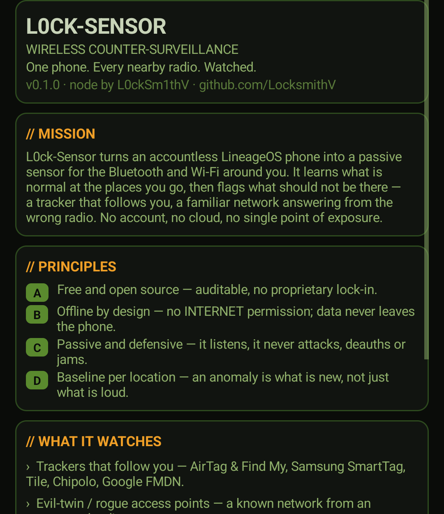

# L0ck-Sensor

**Passive wireless counter-surveillance for Android.**

L0ck-Sensor turns an accountless [LineageOS](https://lineageos.org/) phone into a
standalone sensor for the Bluetooth (BLE) and Wi-Fi around you. It learns what is
*normal* at the places you go, then flags what should not be there — a tracker that
follows you, a familiar network answering from the wrong radio, a device that keeps
reappearing across your locations.

It is **defensive and passive**: it listens and records, it never attacks, deauths,
jams or de-pairs anything. It holds **no `INTERNET` permission** — nothing it
collects can leave the phone unless you export it yourself.



## What it detects

- **Trackers that follow you** — Apple AirTag & Find My accessories (including the
  "separated from owner" state), Samsung SmartTag, Tile, Chipolo, Google Find My
  Device (FMDN). Recognised by advertising payload, not by address, so rotating
  MACs don't hide them.
- **Evil-twin / rogue access points** — a known SSID appearing from an unexpected
  BSSID or vendor, or a secured network suddenly offered open. APs are fingerprinted
  by their vendor information elements and WPS data, not just the name.
- **Follow-me devices** — anything (tracker or not) seen across several distinct
  places over time.
- **Beacons** — iBeacon (UUID / major / minor) and Eddystone frames.

For each device it estimates a rough **distance** and whether it is **approaching or
receding** (from RSSI trend), and shows the raw advert (manufacturer IDs, service
UUIDs, service data).

## Requirements

- An Android phone running LineageOS, Android 13 or newer (developed and tested on
  Android 15), with Bluetooth LE and Wi-Fi.
- A Linux laptop with [Android `platform-tools`](https://developer.android.com/tools/releases/platform-tools)
  (`adb`) to build and install. No root required on the phone.

## Build & install

The build toolchain (JDK 21, Gradle 8.9, Android SDK 35) is **not** included. The
helper script expects it under `~/.l0ck-toolchain` (or set
`L0CK_TOOLCHAIN`); install Temurin JDK 21, Gradle 8.9 and the Android SDK
(`platforms;android-35`, `build-tools;35.0.0`) there, then:

```bash
bash scripts/build-app.sh      # builds app/build/outputs/apk/debug/app-debug.apk
bash scripts/install-app.sh    # installs it onto the connected phone over adb
```

The app is plain Java with **no AndroidX** and no third-party dependencies.

## Usage

1. Open **L0ck-Sensor** and grant Location + Nearby-devices permissions. For
   scanning with the screen off, set Location to **"Allow all the time"**.
2. **Record a baseline.** Choose *Record baseline*, type a location tag (e.g.
   `home`, `work`), press **Start**, leave it a while at that place, then **Stop**.
   Repeat over time to build a good picture of what's normal there.
3. **Monitor.** Switch to *Monitor* and Start. With a tag it compares against that
   place's baseline; with no tag (roaming) it compares against every baseline, so a
   network you only know from home turning up elsewhere raises an alert. Anomalies
   arrive as notifications; a HIGH finding (a tracker confirmed following you) also
   sounds an alarm and vibrates.
4. **Read the tabs** — *Devices* (everything, closest first), *Trackers*, *Wi-Fi*,
   *Alerts*, *About*.
5. **Investigate a suspect.** On a tracker or connectable device, *Investigate (read
   GATT)* connects as a normal BLE client and reads its Device Information (make,
   model, firmware, battery). It is **read-only** — no writes, no interference.

## Project layout

| Path        | Content                                                     | In git |
|-------------|-------------------------------------------------------------|--------|
| `app/`      | the Android app (sources, manifest, resources, Gradle)      | yes    |
| `scripts/`  | build/install and helper scripts                            | yes    |
| `web/`      | a drop-in project page in the site's style                  | yes    |
| `docs/`     | screenshots and docs                                        | yes    |
| `baseline/` | merged baseline snapshots you record (starts empty)         | yes    |
| `logs/`     | timestamped session captures                                | no     |
| `apks/`     | any sideloaded F-Droid APKs                                 | no     |

## Scripts

- `scripts/build-app.sh` — build the debug APK with the local toolchain.
- `scripts/install-app.sh` — install the built APK over `adb`.
- `scripts/test-monitor-adapter.sh` — receive-only check that a USB Wi-Fi adapter
  works in monitor mode on the laptop (auto-detects the interface). Needs `sudo`.
- `scripts/pull-logs.sh` — **prepared, inactive.** Pulls the sensor's NDJSON logs off
  the phone; an optional `--send` copies them to a host taken from environment
  variables (nothing is baked in).
- `scripts/correlate.py` — **prepared, inactive.** Cross-checks the phone's Wi-Fi/BLE
  logs against a laptop monitor-mode capture.

## Data format

Each session writes newline-delimited JSON to the app's external files dir
(`Android/data/cz.l0ck.sensor/files/logs/<date>/`): one record per device per scan
cycle for `wifi` and `ble`, plus `alerts`. SSIDs and device names (attacker-settable
broadcast fields) are stripped of control characters on capture.

## Scope

Out of scope by design: any active interference with other people's devices or
networks — no deauth/disassoc, no frame injection, no jamming, no forced de-pairing,
no rogue-AP broadcasting. The only active feature is the read-only GATT probe above.

## License

See [`LICENSE`](LICENSE).
